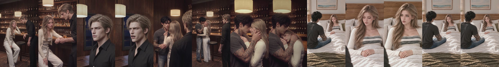
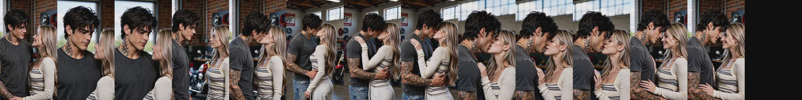
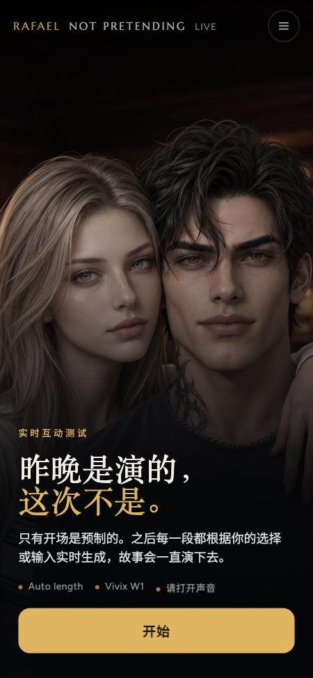
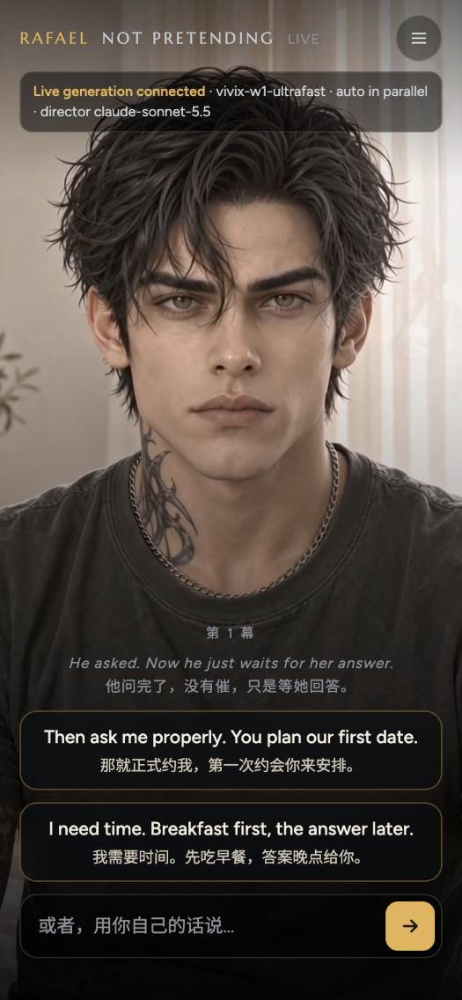
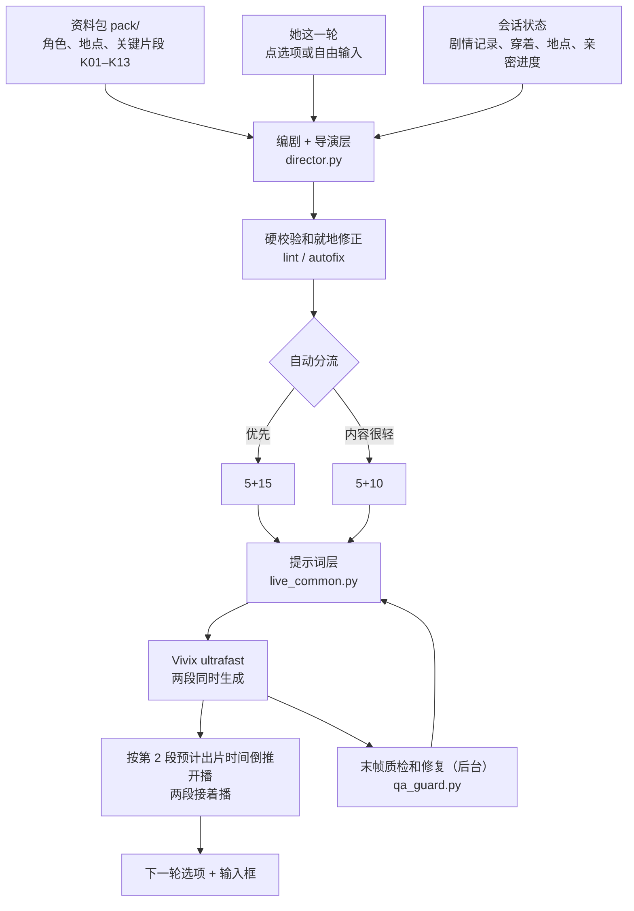

<p align="center"></p>

<h1 align="center">Rafael｜这次，不是演的</h1>
<p align="center"><b>Not Pretending This Time</b> · 女性向第三视角开放式实时互动剧</p>
<p align="center"><a href="https://lyx1265897416-lab.github.io/rafael-not-pretending/">▶ 打开体验页</a></p>

只有开场是预制的。之后每一段视频，都根据观众点的选项或自己打的一句话实时生成，故事一直往下演。

> 不带口令打开时只能看开场。实时生成要用带口令的测试链接，并且要这台 Mac 开着：中转和模型 key 都在本机，不在仓库里。

## 故事

认识六年、合租三年的修车店老板 Rafael，昨晚为了替她挡住前任，临时扮演男友，有过一个吻。今天清晨，他承认临时的是男友身份，喜欢她不是，并清醒地正式约她。接下来怎么答，由观众决定：接受、需要时间、维持朋友、拒绝都是有效剧情。

### 开场：昨晚的吻 → 清晨空镜 → 今早的告白（101.5 秒）



吻戏 V7（61 秒）→ 窗边空镜（5 秒，黎明到早晨）→ 开场 V20（35.5 秒），统一 720p 和 -16 LUFS。开场播完停在 Rafael 正面近景等她回答，接着出选项。

### 角色


## 实时生成实测

2026-10-31 首轮冒烟测试，一个自动分流的会话跑了 4 轮，每行约每 1.6 秒抽一帧。

| 她的输入 | 时长 | 发送到两段生成好 | 画面 |
|---|---|---|---|
| 那就正式约我（选项 A） | 5+15 | 48.3 秒 |  |
| 嗯 | 5+10 | 35.2 秒 |  |
| 带我去你店里看看 | 5+15 | 45.2 秒 |  |
| 吻我 | 5+15 | 40.2 秒 |  |

另外在播放页上跑了 2 轮，接缝停顿都是 0 秒：点选项发送到开播 41.5 秒；从 GitHub Pages 自由输入“带我去海边吹吹风”116.7 秒，其中第 1 段在 Vivix 排队 99.6 秒，第 2 段从提交到出片只用了 22 秒。

<table>
<tr>
<td width="300"></td>
<td width="300"></td>
<td width="300"></td>
</tr>
<tr>
<td align="center">第 4 轮持续吻（<a href="assets/samples/round4_kiss.mp4">看原片</a>）</td>
<td align="center">开始页</td>
<td align="center">选择点：两个选项 + 自由输入</td>
</tr>
</table>

第 3 轮换场到修车店的原片：[round3_shop.mp4](assets/samples/round3_shop.mp4)

### 已知问题

- 她的外形会漂移：质检报过发色偏暖金、粉色指甲、疑似戒指、脸偏幼态。只在后台修末帧，下一轮发得快时会先用没修的帧。
- 卧室里不同镜头的窗和墙变化偏大，空间不如预制开场稳定。
- 第 3 轮有一个切点混了一帧。
- 实时段用模型自带的声音，没有绑定 Rafael 声纹，口型和听感没有逐条核对。

## 链路



每条实时视频固定三段：回应她的话 → 演绎 → 引出钩子。男左女右不越轴，换场先切空镜，每段最后停在两人同框。

## 目录

| 路径 | 内容 |
|---|---|
| `docs/` | 播放页，由 GitHub Pages 提供；`relay.json` 是当前的中转地址 |
| `raf_third_relay.py` | 中转服务（端口 8901） |
| `director.py` | 编剧、导演分镜 PE 和硬校验 |
| `live_common.py` | 提示词层 |
| `qa_guard.py` | 末帧和段内质检、修图 |
| `pack/` | 资料包（由 `build_pack.py` 生成） |
| `masters/`、`masters.py` | 身份母版、站位图、起始关键帧 |
| `stitch.py` | 拼接开场 |
| `sync_relay.py` | 隧道地址变了就更新 `docs/relay.json` |
| `raf_third_sim.py`、`replay.py`、`tests/smoke.py` | 模拟用户、重放、冒烟测试 |

流程和 PE 规则复制自 Magnus 第三视角实时版（V1.9），角色、世界观、地点和时间换成 Rafael 内容包。

## 本地运行

需要自备 Vivix 和 OpenRouter 的 key，并生成一份 `token.txt` 作为口令：

```bash
python3 -u raf_third_relay.py "$(cat token.txt)" 8901
```

然后打开 `http://127.0.0.1:8901/?k=<口令>&lang=zh`。代码里写了作者本机的路径，换机器运行要先改。
